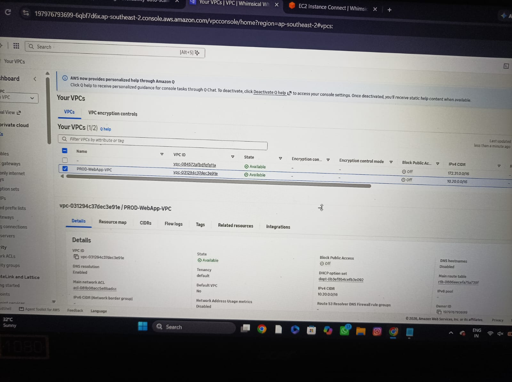
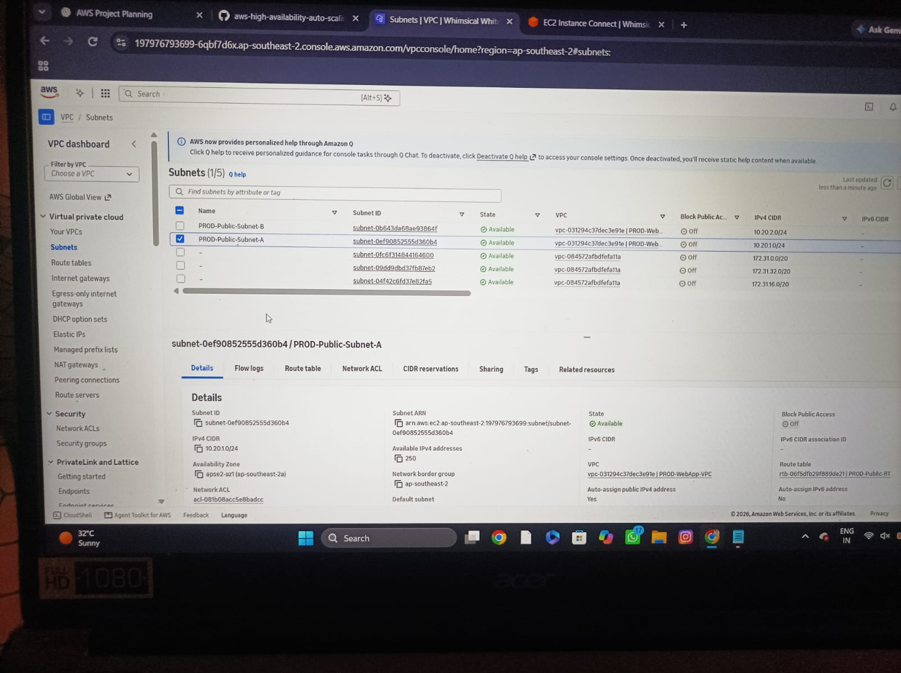
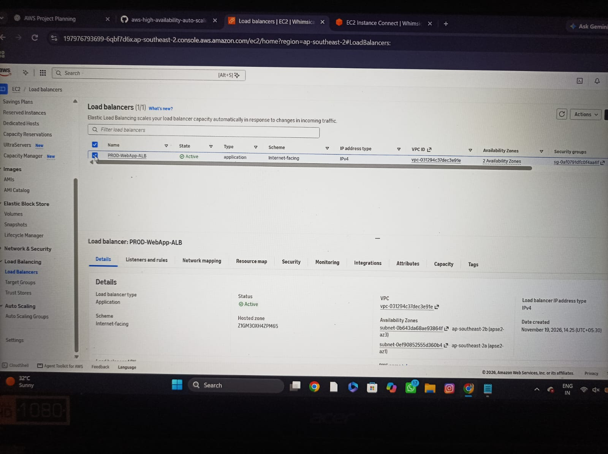
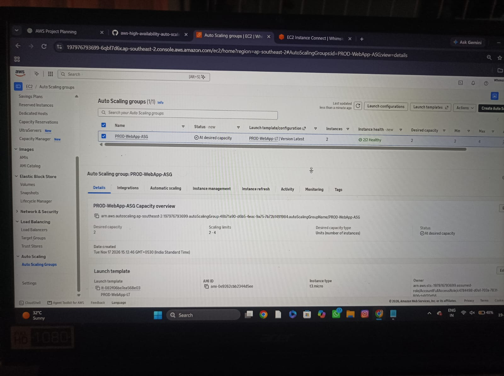
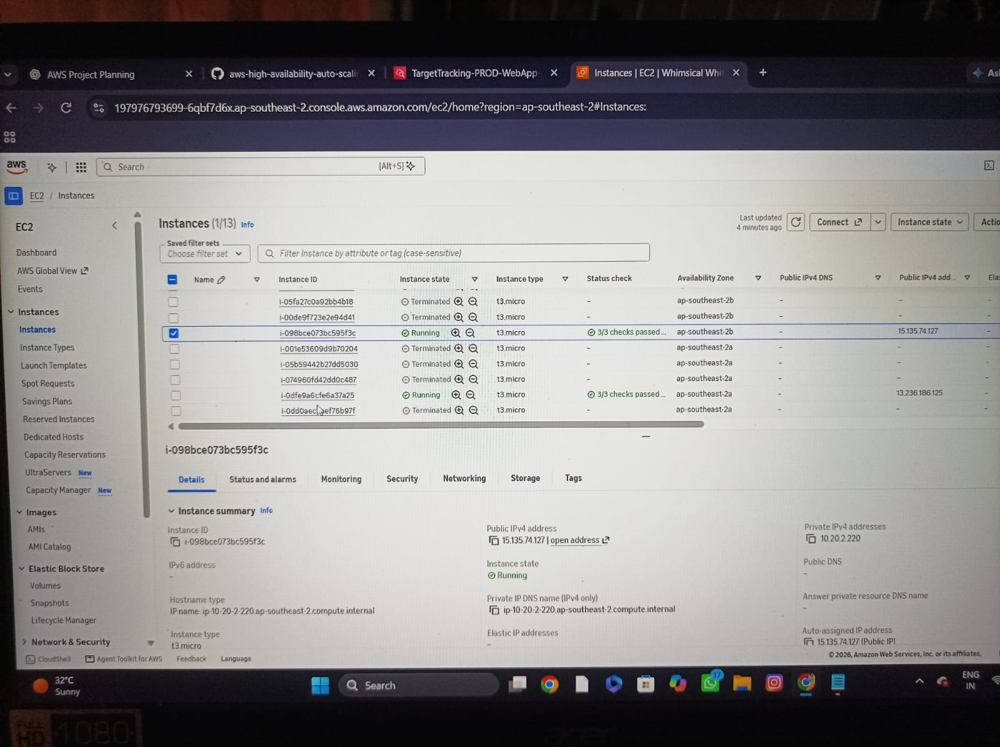
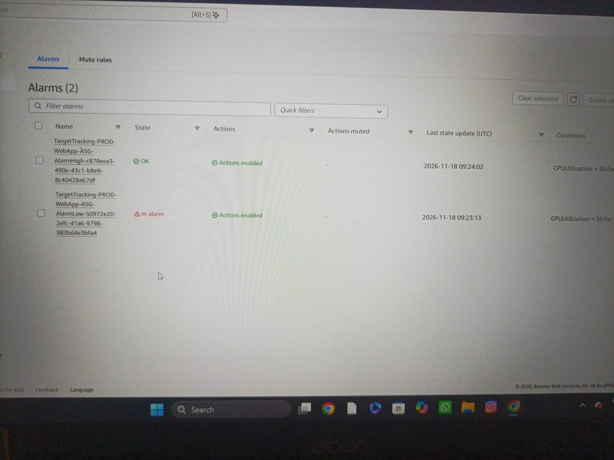
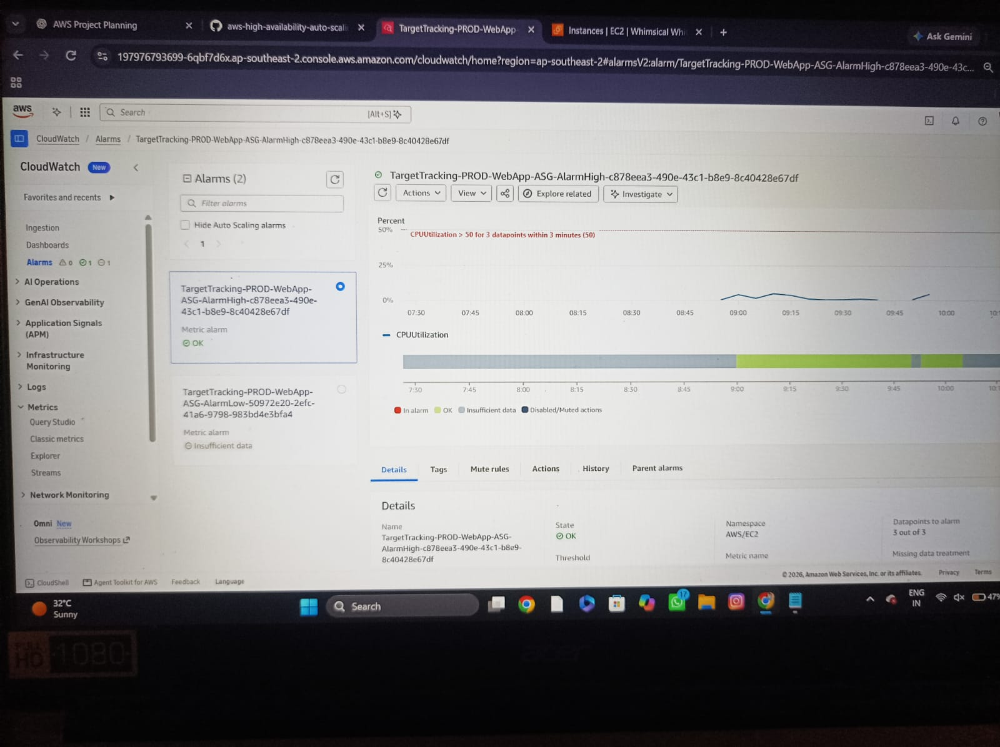
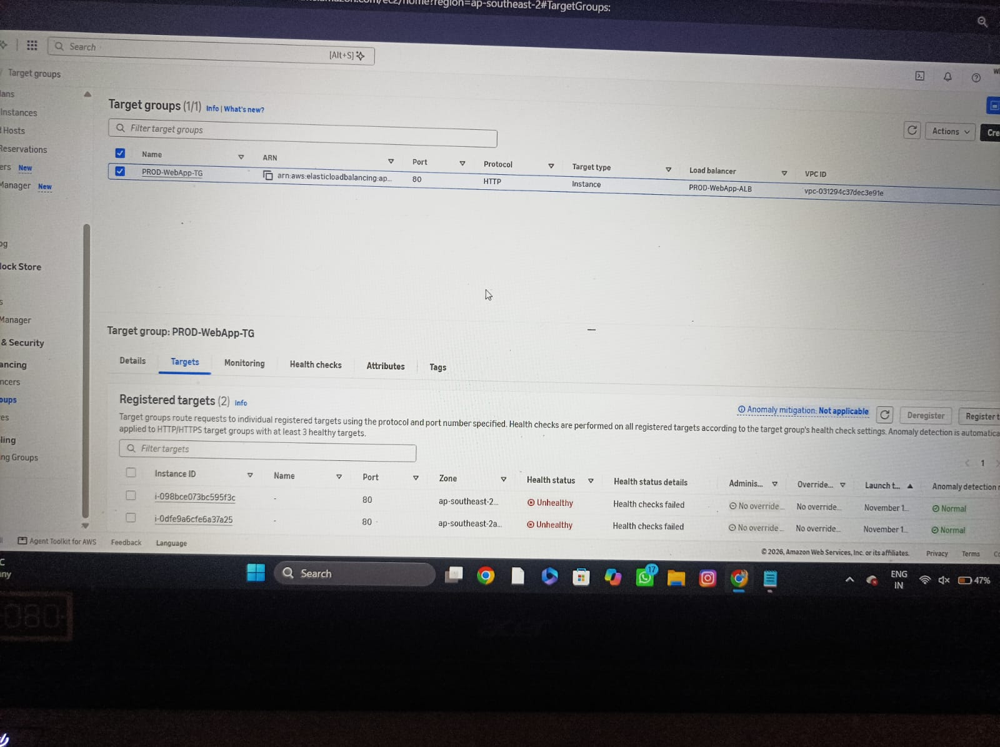
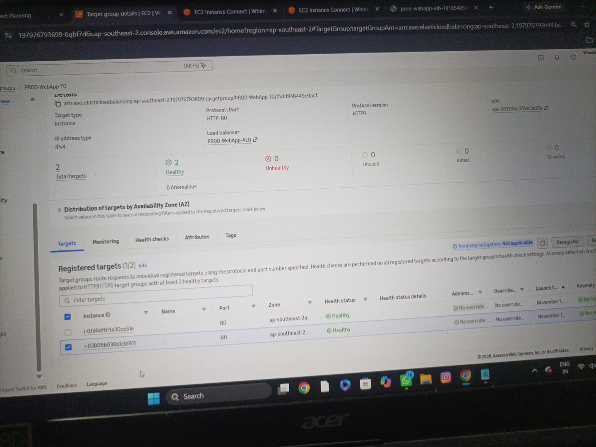

# Highly Available & Auto-Scaling Web Application on AWS

## Project Overview

This project demonstrates the deployment of a highly available and auto-scaling web application using AWS.

The application runs on two EC2 instances across two Availability Zones. An Application Load Balancer distributes incoming HTTP traffic, while an Auto Scaling Group maintains the desired capacity.

## AWS Region
- Sydney (`ap-southeast-2`)

## AWS Services Used
- Amazon VPC
- Public Subnets
- Internet Gateway
- Route Tables
- Security Groups
- Amazon EC2
- Launch Templates
- Auto Scaling Group
- Application Load Balancer
- Target Groups
- Amazon CloudWatch

## Network Configuration
- VPC: `PROD-WebApp-VPC`
- CIDR: `10.20.0.0/16`
- Public Subnet A: `10.20.1.0/24`
- Public Subnet B: `10.20.2.0/24`
- Availability Zones: `ap-southeast-2a` and `ap-southeast-2b`

## Auto Scaling Configuration
- Minimum Capacity: 2
- Desired Capacity: 2
- Maximum Capacity: 4
- Scaling Policy: Target Tracking
- Target CPU Utilization: 50%

## Application Deployment
- Operating System: Amazon Linux 2023
- Web Server: Apache HTTP Server
- Deployment: EC2 Launch Template User Data

## Testing Performed

1. Website accessibility through ALB DNS.
2. Auto Scaling Scale-Out test using CPU load.
3. Auto Scaling Scale-In test.
4. ALB health-check failover test.
5. Application recovery test after restarting Apache.

## Final Verification
- ASG Desired Capacity: 2
- InService EC2 Instances: 2
- Target Group Healthy Targets: 2/2
- ALB Website: Working
- Scale-Out and Scale-In: Successful
- Failover and Recovery: Successful

## Key Learnings
- AWS networking and VPC configuration.
- Multi-AZ architecture.
- EC2 deployment and Apache configuration.
- Load balancing and health checks.
- Auto Scaling policies.
- CloudWatch monitoring.
- Troubleshooting unhealthy targets.

## Project Status
Completed hands-on AWS learning project.

## Project Screenshots

### VPC Configuration

### Public Subnets

### Application Load Balancer

### Auto Scaling Group

### EC2 Instances

### CloudWatch Alarms

### CPU Monitoring

### Failover Test

### Recovery Test

